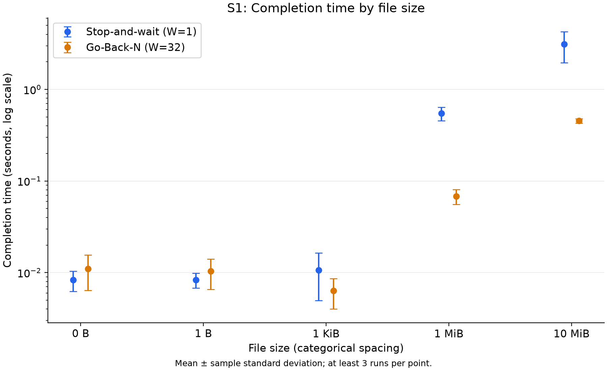
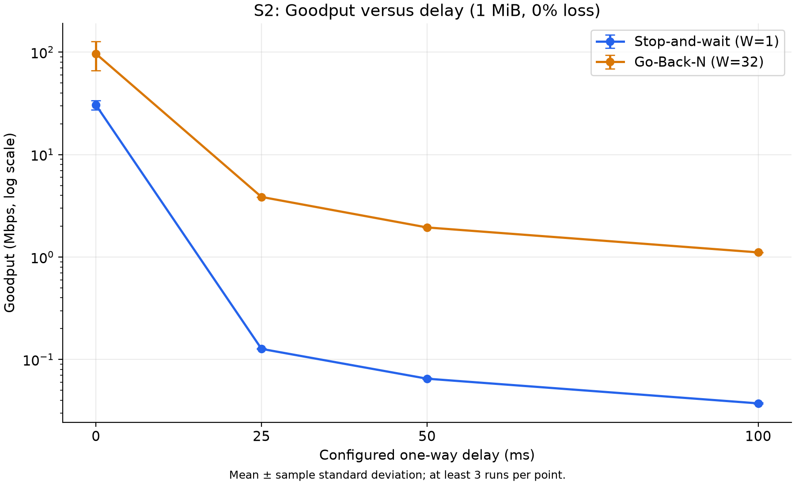
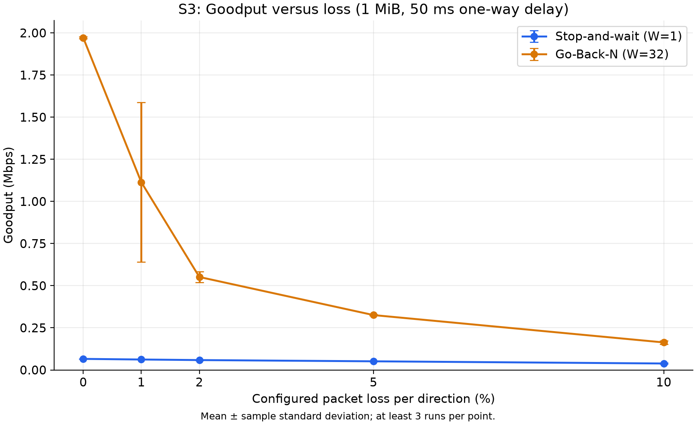
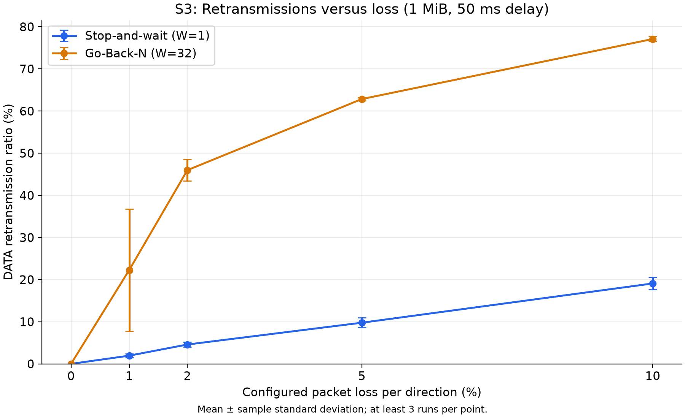

# Week 4: First Results and Analysis

Member A: Afeera Usman
Group 12: Reliable File Transfer over UDP

## 1. Aim

This week, I used the experiment results generated by Member B
to compare stop-and-wait (window 1) with Go-Back-N (window 32).

I wrote experiments/plot.py to check the results, calculate
summary statistics and generate graphs for scenarios S1 to S3.

## 2. Data Checks

The three CSV files contain 86 runs:

| Scenario | Runs | Successful runs | Matching hashes |
|---|---:|---:|---:|
| S1: File sizes | 32 | 32 | 32 |
| S2: Delay | 24 | 24 | 24 |
| S3: Packet loss | 30 | 30 | 30 |
| Total | 86 | 86 | 86 |

No duplicate configuration and repetition keys were found.

The standard configurations have three repetitions each.
S1 also contains one 64 KiB run for each mode. These two
single-run configurations are included in the correctness
table but excluded from the main S1 performance graph.

The graphs show means with sample standard deviation.
These error bars describe variation between runs, not
confidence intervals.

## 3. S1: File Size and Correctness

Both modes transferred all tested files with matching SHA-256
hashes, including empty files and one-byte files.

For very small files, completion times were similar. Setup,
completion messages and operating-system scheduling are likely
to contribute a large part of the total time.

For the 1 MiB and 10 MiB files, window 32 completed faster.
It can send several chunks before waiting, while stop-and-wait
waits for an acknowledgement after each chunk.

The graph uses a logarithmic time axis because completion
times cover a wide range. File sizes are shown as categories,
not as equally spaced numerical sizes.

## 4. S2: Effect of Delay

S2 uses a 1 MiB file and 0% configured packet loss.
Delay is applied separately in both directions.

Goodput is the original file size in bits divided by total
completion time, excluding retransmitted bytes from the
useful-data count.

| One-way delay | Window 1 goodput, mean ± SD (Mbps) | Window 32 goodput, mean ± SD (Mbps) |
|---|---:|---:|
| 0 ms | 30.471667 ± 3.119367 | 96.390333 ± 30.541284 |
| 25 ms | 0.127000 ± 0.001000 | 3.860333 ± 0.006110 |
| 50 ms | 0.065000 ± 0.001000 | 1.944667 ± 0.001528 |
| 100 ms | 0.037333 ± 0.000577 | 1.110667 ± 0.004726 |

Each value is based on three runs.

Goodput decreased as delay increased. Stop-and-wait was
affected more because it waits for a complete round trip
after every chunk.

At 50 ms one-way delay, the ratio of mean goodputs was:

1.944667 / 0.065000 = approximately 29.92

This exceeds the objective of at least 10 times the goodput
with window 32 under these conditions.

Window 32 had considerable variation in the no-delay runs.
These measurements include Python, proxy and operating-system
overhead, so they should not be treated as physical network
bandwidth measurements.

Window 1 recorded a mean retransmission ratio of 0.033333%
at 50 ms, despite 0% configured loss. Configured loss does not
exclude local drops or timeout events. The exact cause cannot
be established from this summary alone.

The goodput axis uses a logarithmic scale so both modes
remain visible.

## 5. S3: Effect of Packet Loss

S3 uses a 1 MiB file and 50 ms configured one-way delay.
The loss percentage applies independently in each direction.

| Loss per direction | Window 1 goodput, mean ± SD (Mbps) | Window 32 goodput, mean ± SD (Mbps) |
|---|---:|---:|
| 0% | 0.065667 ± 0.000577 | 1.971000 ± 0.005568 |
| 1% | 0.062000 ± 0.001000 | 1.114000 ± 0.473079 |
| 2% | 0.058667 ± 0.002517 | 0.551667 ± 0.031974 |
| 5% | 0.051333 ± 0.001528 | 0.325667 ± 0.002887 |
| 10% | 0.038333 ± 0.003215 | 0.163333 ± 0.010017 |

Each value is based on three runs.

Both modes became slower as loss increased. Window 32
remained faster at every tested loss rate, but its advantage
became smaller as loss increased.

At 1% loss, window 32 showed relatively high variation between
runs. Three repetitions give only an initial estimate of that
variation.

### Retransmissions

The retransmission ratio is:

DATA retransmissions / total DATA transmissions × 100

The table below shows the mean of the per-run ratios.

| Loss per direction | Window 1 retransmission ratio (%) | Window 32 retransmission ratio (%) |
|---|---:|---:|
| 0% | 0.00 | 0.00 |
| 1% | 1.95 | 22.26 |
| 2% | 4.59 | 45.98 |
| 5% | 9.77 | 62.85 |
| 10% | 19.08 | 77.10 |

Go-Back-N retransmitted a larger proportion of DATA packets.
A timeout causes it to resend the whole outstanding window.
The receiver also discards out-of-order chunks, which can
increase the amount of data that must be sent again.

With stop-and-wait, only one chunk is outstanding at a time.

Loss affects both DATA and ACK packets. For example, at 5%
independent loss in each direction, the probability that a
DATA/ACK exchange suffers at least one loss is:

1 - (0.95 × 0.95) = 9.75%

The observed stop-and-wait mean ratio of 9.77% is close to
this value. This is an approximate comparison because the
measurements also include timing and implementation effects.

## 6. Limitations

- These results come from a Python impairment proxy on Windows.
- Configured delay is not the same as measured RTT.
- Measured probe RTT is preserved in the summary CSV files.
- Each main configuration has only three repetitions.
- No-delay performance can be limited by the local software
  and operating system.
- Packet-capture counter validation remains unverified because
  Tshark was unavailable, as noted in Member B's documentation.
- S4 and later scenarios are outside this initial S1-S3 analysis.

## 7. Files Produced

Script:

- experiments/plot.py

Summary tables:

- results/plots/s1_summary.csv
- results/plots/s1_correctness.csv
- results/plots/s2_summary.csv
- results/plots/s3_summary.csv

Graphs, saved in both PNG and PDF formats:

- s1_completion_by_size
- s2_goodput_vs_delay
- s3_goodput_vs_loss
- s3_retransmissions_vs_loss

The source experiment CSV files are left unchanged.

## 8. How to Reproduce

Run these commands from the project root:

    python -m pip install pandas matplotlib
    python experiments/plot.py

The script reads results/s1.csv, results/s2.csv and
results/s3.csv. It checks the inputs and saves the summaries
and figures in results/plots.