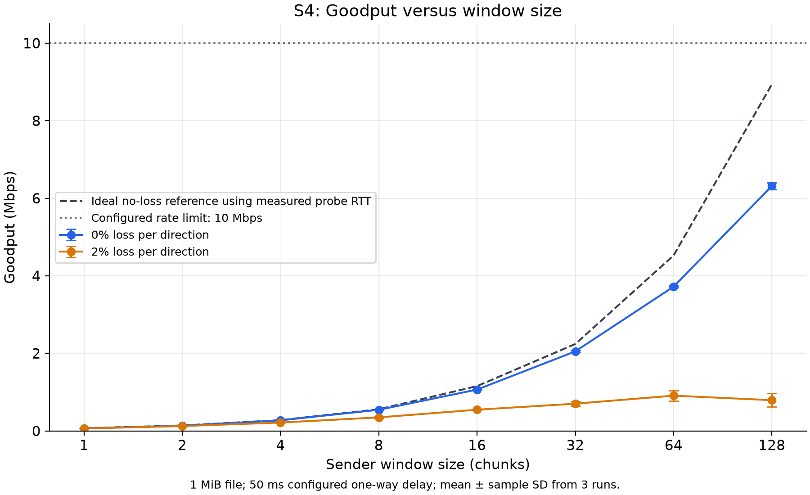
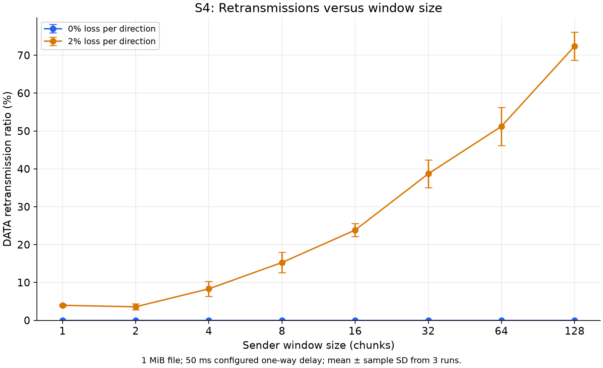

# Week 5: Window Size Analysis

Member A: Afeera Usman
Group 12: Reliable File Transfer over UDP

## 1. Aim

This experiment investigates how the sender window size
affects goodput and retransmissions, with and without loss.

## 2. Experiment Settings

| Setting | Value |
|---|---|
| File size | 1 MiB (1,048,576 bytes) |
| Chunk size | 1,024 bytes |
| Windows | 1, 2, 4, 8, 16, 32, 64, 128 |
| Configured one-way delay | 50 ms |
| Packet loss per direction | 0% and 2% |
| Rate limit per direction | 10 Mbps |
| Repetitions per configuration | 3 |
| Total transfers | 48 |

The experiments ran on Windows through the Python impairment
proxy. The campaign finished in approximately 29.1 minutes.

Measured probe RTT ranged from 113.49 to 118.04 ms across
the configurations.

## 3. Data Validation

All 48 runs reported OK and passed the independent SHA-256
check. No duplicate configuration and repetition keys were
found.

All 16 configurations contained repetitions 1, 2 and 3.
The plotting script also checked the file size, delay,
rate limit and impairment settings.

Results are reported as means with sample standard deviations.
Error bars describe variation between three runs; they are
not confidence intervals.

## 4. Goodput Results

| Window | 0% loss: mean ± SD (Mbps) | 2% loss: mean ± SD (Mbps) |
|---|---:|---:|
| 1 | 0.0660 ± 0.0000 | 0.0620 ± 0.0010 |
| 2 | 0.1327 ± 0.0012 | 0.1240 ± 0.0035 |
| 4 | 0.2723 ± 0.0040 | 0.2150 ± 0.0128 |
| 8 | 0.5443 ± 0.0015 | 0.3480 ± 0.0255 |
| 16 | 1.0650 ± 0.0030 | 0.5463 ± 0.0212 |
| 32 | 2.0510 ± 0.0265 | 0.7017 ± 0.0624 |
| 64 | 3.7197 ± 0.0244 | 0.9090 ± 0.1347 |
| 128 | 6.3147 ± 0.0866 | 0.7920 ± 0.1743 |

Values are rounded. A displayed standard deviation of zero
does not prove that the underlying execution times were
identical because the source goodput values are rounded.

Without configured loss, goodput increased with every tested
window size. A larger window allows more chunks to be sent
before the sender must wait for acknowledgements.

At 2% loss, window 64 had the highest measured mean goodput.
Window 128 had a lower mean and greater retransmission overhead.

However, the variation for windows 64 and 128 overlaps.
With only three runs each, these results do not establish
that window 64 is always the best choice.

## 5. Retransmission Results

The retransmission ratio is:

DATA retransmissions / total DATA transmissions × 100

The following values are means of the per-run ratios.

| Window | 0% loss ratio (%) | 2% loss ratio (%) |
|---|---:|---:|
| 1 | 0.00 | 3.97 |
| 2 | 0.00 | 3.57 |
| 4 | 0.00 | 8.32 |
| 8 | 0.00 | 15.27 |
| 16 | 0.00 | 23.84 |
| 32 | 0.00 | 38.71 |
| 64 | 0.00 | 51.23 |
| 128 | 0.00 | 72.40 |

No DATA retransmissions were recorded in the no-loss runs.

Under 2% loss, retransmission overhead generally increased
with window size. Go-Back-N resends every outstanding chunk
after a timeout. The receiver discards chunks arriving ahead
of the expected chunk, so some correctly delivered chunks
must be sent again.

The small difference between windows 1 and 2 should not be
treated as a general trend from only three repetitions.

## 6. Theoretical Comparison

The graph includes this ideal no-loss reference:

min(window × chunk size in bits / measured probe RTT,
    configured link rate)

RTT is converted from milliseconds to seconds.
The result is converted to Mbps.

The plotted reference is calculated for each no-loss run
and then averaged for each window size.

For window 128 and a measured RTT of 117.34 ms:

128 × 1024 × 8 / 0.11734 ≈ 8.94 Mbps

This is below the configured 10 Mbps rate limit.
The measured mean goodput was approximately 6.31 Mbps.

The measured value can fall below the ideal reference because
the simple model excludes setup and teardown, packet
serialization, finite-file effects and software overhead.
Probe RTT may also differ from RTT during a busy transfer.

The curve is an ideal reference for the no-loss case, not
a prediction for the 2% loss runs.

Using the no-loss probe RTT range, the approximate
bandwidth-delay product is 142 to 148 chunks:

required chunks ≈ rate × RTT / chunk size in bits

Therefore, the largest tested window of 128 does not fully
cover that estimated bandwidth-delay product. These runs do
not demonstrate a no-loss saturation point.

## 7. Findings and Limitations

- Larger windows substantially improved goodput without loss.
- Packet loss reduced the benefit of increasing the window.
- Window 128 produced the highest no-loss mean goodput.
- Window 64 produced the highest mean at 2% loss in this sample.
- These results describe Go-Back-N, not Selective Repeat.
- Only three repetitions were collected per configuration.
- Measurements include Windows and Python proxy overhead.
- Source goodput values are rounded.
- Packet-capture counter validation was not performed here.

## 8. Files Produced

- results/s4.csv
- results/plots/s4_summary.csv
- results/plots/s4_goodput_vs_window.png
- results/plots/s4_goodput_vs_window.pdf
- results/plots/s4_retransmissions_vs_window.png
- results/plots/s4_retransmissions_vs_window.pdf
- docs/week5-analysis.md

The plotting functionality was added to experiments/plot.py.

## 9. Reproduction

Run from the project root:

    python experiments/run_experiments.py --scenario s4 --resume
    python experiments/plot.py

The first command runs or resumes the experiment campaign.
The second reads the saved CSV files and regenerates the
summary tables and graphs.

## 10. Scope of This Update

This update covers S4 window-size experiments and analysis.
The optional E2 adaptive-timeout extension is not implemented
or evaluated by this update.